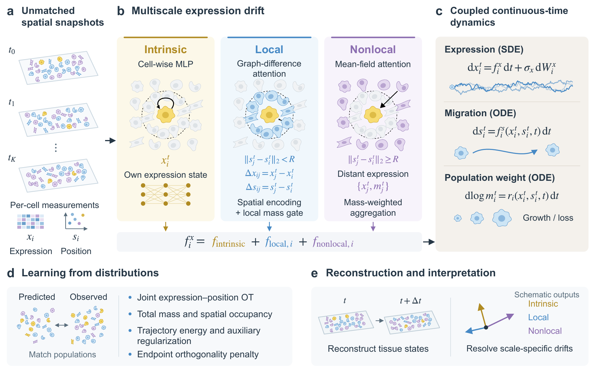

# stMIND: Learning multiscale interaction dynamics from spatial-temporal transcriptomics

**Authors**: Longquan Li and Lin Wan



Interactions within local cellular neighborhoods and across broader tissue scales jointly govern molecular state transitions and morphogenesis during development and regeneration. While time-series spatial transcriptomics simultaneously profiles gene expression and spatial coordinates, destructive sequencing samples distinct cells at each time point, leaving intermediate trajectories and multiscale intercellular interactions unobserved. Building upon our interacting mean-field neural stochastic differential equation framework, we present stMIND (Spatiotemporal Multiscale Interaction Neural Dynamics), a continuous-time generative framework that infers coupled molecular, spatial, and proliferation dynamics from unmatched spatiotemporal snapshots. stMIND decomposes cellular expression velocity vector/drift into three interpretable operators: a cell-intrinsic program, a local graph-difference attention operator that aggregates relative expression differences and spatial geometry within a co-evolving physical radius, and a nonlocal mean-field attention operator that captures long-range population context beyond the immediate neighborhood. By evolving dynamic spatial neighborhoods alongside cellular migration and enforcing orthogonality between intrinsic and interaction-driven drifts, stMIND resolves scale-specific intercellular influences through optimal transport in joint expression–position space. Across benchmarks in axolotl brain regeneration and zebrafish embryogenesis, stMIND achieves the highest gene-expression prediction accuracy, anatomical consistency and spatial coherence. Ablation studies confirm that combining disjoint local and nonlocal operators is essential for accurately reconstructing cellular microenvironments. Furthermore, stMIND uncovers a critical regenerative transition at 10–15 days post-injury in the axolotl telencephalon—marked by a surge in total drift energy followed by nonlocal dominance and cell-type-specific local counterbalance within reactive ependymoglial niches. In addition, it accurately tracks stage-dependent developmental vector fields in zebrafish.

# Datasets

We used spatial-transcriptomic sections from the [ARTISTA atlas](https://db.cngb.org/stomics/artista/download/) of axolotl telencephalon regeneration after injury and the [ZESTA atlas](https://db.cngb.org/stomics/zesta/download/) of zebrafish embryogenesis. The datasets are available through STOmicsDB under accessions STDS0000056 (CNSA project CNP0002068) and STDS0000057 (CNSA project CNP0002220), respectively; their study portals are [ARTISTA](https://db.cngb.org/stomics/artista/download/) and [ZESTA](https://db.cngb.org/stomics/zesta/download/).

Detailed pre-processing steps for these datasets can be found in the catalogues [./data/axolotl](./data/axolotl) and [./data/zebrafish](./data/zebrafish).

# Getting Started

stMIND takes time-series spatial-transcriptomics data as input and outputs:

- reconstructed gene-expression states, tissue positions and positive particle weights over time,
- inferred intrinsic, local and nonlocal expression velocities, together with spatial migration velocities,
- cell-wise attention scores describing local and nonlocal cellular context during tissue dynamics.

This code release provides the full axolotl 2–60 DPI and zebrafish 3.3–24 hpf experiments, both with seed 0. Use `--dataset axolotl` or `--dataset zebrafish` with `train.py`, `prediction.py` and `Eval/readout.py` to select the corresponding experiment.

## Requirements and Setup

```bash
conda create -n stmind python=3.12
conda activate stmind
pip install -r requirements.txt
```

Prepare the inputs and train each model:

```bash
# Axolotl: 2, 5, 10, 15, 20, 30 and 60 DPI
python data/axolotl/prepare.py --source /path/to/Regeneration.h5ad --output inputs/axolotl
python train.py --dataset axolotl --input inputs/axolotl/training.npz --output Output/axolotl_seed0 --device cuda:0 --allow-reprocessed-input

# Zebrafish: 3.3, 5.25, 10, 12, 18 and 24 hpf
python data/zebrafish/prepare.py --source /path/to/zebrafish_stvcr_ready.h5ad --output inputs/zebrafish
python train.py --dataset zebrafish --input inputs/zebrafish/training.npz --output Output/zebrafish_seed0 --device cuda:0 --allow-reprocessed-input
```

